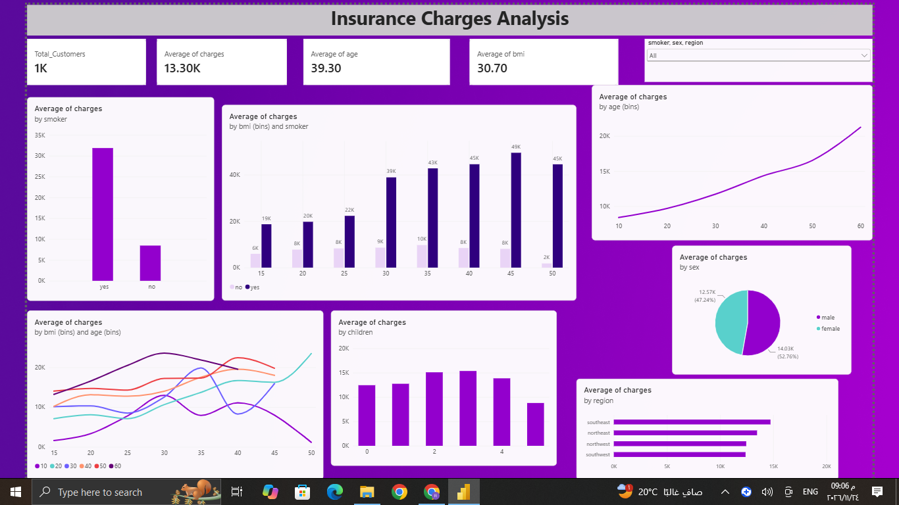

# Insurance Charges Analysis

Analysis and prediction of medical insurance charges using **Python** (data cleaning, EDA, regression model) and an interactive **Power BI** dashboard.

## Project Goal

Understand which customer characteristics drive insurance costs, and build a model that predicts charges from them.

## Dataset

The dataset (`Insurance_Dirty.csv`) has 1,339 rows and 7 columns:

| Column | Description |
|---|---|
| age | Age of the customer |
| sex | Male / female |
| bmi | Body mass index |
| children | Number of children |
| smoker | Smoker (yes / no) |
| region | Residential region (northeast, northwest, southeast, southwest) |
| charges | Insurance charges (target) |

The raw data contains typical quality problems: duplicates, inconsistent text, typos, missing values and invalid values.

## Tools

- Python: pandas, NumPy, Matplotlib, Seaborn, scikit-learn
- Power BI
- Google Colab

## Data Cleaning

- Removed 2 duplicate rows
- Standardized text columns (trimmed spaces, lowercase)
- Fixed typos (e.g. "thirty" to 30) and converted columns to numeric types
- Treated invalid values (negative age, BMI and children) as missing
- Filled missing values with the median (numeric) or mode (categorical)
- Removed 1 negative charge and 1 impossible BMI value (120)

Result: 1,333 clean rows with no missing values.

## Key Insights

1. **Smoking is the strongest cost driver.** Smokers pay about 32K on average vs about 8K for non-smokers (roughly 4x).
2. **Charges rise steadily with age**, from about 8K for the youngest group to about 21K for the oldest.
3. **High BMI raises costs mainly for smokers.** For non-smokers charges stay flat (about 8-10K); for smokers they jump to 40-50K once BMI reaches about 30.
4. **Region and sex have only a small effect** compared with smoking and age.

## Predictive Model

- Categorical features encoded (sex, smoker as 0/1, region one-hot)
- Linear Regression on degree-2 polynomial features, scaled with `StandardScaler`
- Train/test split: 75% / 25% (`random_state=42`)

| Metric | Value |
|---|---|
| R² (test) | 0.848 |
| R² (train) | 0.836 |
| MAE | 2,983 |
| RMSE | 4,789 |

Test and train R² are close, so the model does not show signs of overfitting.

## Repository Contents

| File | Description |
|---|---|
| `Insurance_task.ipynb` | Data cleaning, EDA and model |
| `Insurance_Dirty.csv` | Raw dataset |
| `charges_task.pbix` | Power BI dashboard (open with Power BI Desktop) |
| `Insurance_Charges_Presentation.pdf` | Presentation of the findings |

## How to Run

The notebook was built in Google Colab and reads the data from Google Drive. To run it:

1. Upload `Insurance_Dirty.csv` to your Colab session or Drive.
2. Update the path in the cell that calls `pd.read_csv(...)` to match the file location.
3. Run all cells.

## Dashboard

## Author

renadahelmy78-spec
